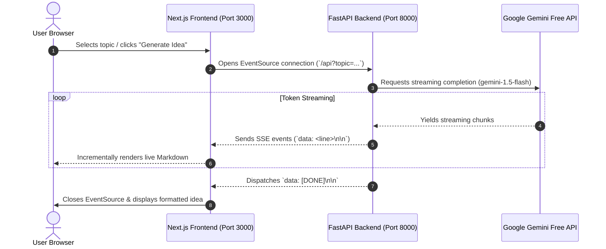

# 💡 IdeaSpark - AI Business Idea Generator (MLOps SaaS Project)

A production-ready full-stack AI SaaS application that generates high-potential startup and business ideas in real-time using **Server-Sent Events (SSE)** streaming, **Google Gemini Free API** (or OpenAI), **FastAPI**, and **Next.js (Pages Router + TypeScript + Tailwind CSS)**.

---

## 🌟 Key Features

- **⚡ Real-Time SSE Streaming**: Token-by-token streaming generation using HTTP Server-Sent Events (`text/event-stream`), avoiding request timeouts on long LLM responses.
- **🆓 Google Gemini Free Tier Native**: Integrated with Google AI Studio's free tier via Gemini's OpenAI-compatible endpoint (`gemini-1.5-flash`), eliminating paid API barriers.
- **🔄 Universal LLM Support & Demo Mode**:
  - `GEMINI_API_KEY`: Uses free-tier Google Gemini model.
  - `OPENAI_API_KEY`: Uses OpenAI models if configured.
  - No Key: Graceful mock streaming demo fallback so the app is always functional.
- **🎨 Modern Glassmorphic UI**:
  - Category presets (AI Agents, Micro-SaaS, HealthTech, FinTech, Climate, E-Commerce).
  - Custom topic and target audience inputs.
  - Markdown typography rendering with `react-markdown` and `remark-gfm`.
  - One-click copy-to-clipboard with visual feedback.
  - Dynamic provider status pill displaying active LLM model.
- **🛠️ Self-Contained Local Full-Stack Architecture**: Local reverse proxy via `next.config.ts` (`/api/*` -> FastAPI on port `8000`), allowing development without cloud serverless dependencies.

---

## 🏗️ Architecture & Data Flow



---

## 🚀 Quick Start Guide

### 1. Prerequisites
- **Node.js**: v18+ or v20+
- **Python**: 3.10+ (tested on Python 3.12)
- **Google Gemini API Key** (Free): Get one in 30 seconds at [Google AI Studio](https://aistudio.google.com/app/apikey).

---

### 2. Configure Environment Variables
Open `.env` (or `saas/.env`) and add your Gemini API key:

```env
# Google Gemini Free API Key
GEMINI_API_KEY=your_actual_gemini_api_key_here

# Model configuration (default: fast, generous free quota)
GEMINI_MODEL=gemini-1.5-flash
```

*(Note: If you leave `GEMINI_API_KEY` blank, the app will automatically run in Demo Mock Stream mode!)*

---

### 3. Run the Full Application

#### Option A: One-Click Launch (PowerShell on Windows)
Simply run:
```powershell
.\run_dev.ps1
```

#### Option B: Manual Two-Terminal Launch

**Terminal 1 (Backend - FastAPI):**
```bash
# From workspace root:
python -m uvicorn saas.api.index:app --host 127.0.0.1 --port 8000 --reload
```
*FastAPI documentation will be accessible at: `http://127.0.0.1:8000/docs`*

**Terminal 2 (Frontend - Next.js):**
```bash
# Navigate to saas folder:
cd saas
npm run dev
```

Visit **`http://localhost:3000`** in your browser!

---

## 📂 Project Structure

```
01-business idea generator/
├── progress.md                 # Single Source of Truth for task phases
├── README.md                   # Complete architectural and setup guide
├── run_dev.ps1                 # Single-click local runner script
├── requirements.txt            # Python dependencies
├── .env                        # Root environment variables
├── api/
│   └── index.py                # Standalone root backend entrypoint
└── saas/                       # Next.js Full-Stack Application
    ├── api/
    │   └── index.py            # FastAPI Streaming Engine (Gemini / OpenAI / Mock)
    ├── pages/
    │   ├── _app.tsx            # Global application wrapper
    │   ├── _document.tsx       # HTML structure and SEO metadata
    │   └── index.tsx           # Interactive Idea Generator UI & SSE Consumer
    ├── styles/
    │   └── globals.css         # Tailwind styles + Custom Markdown typography
    ├── next.config.ts          # Local proxy rewrites (/api -> FastAPI :8000)
    ├── package.json            # Node scripts & dependencies
    ├── tsconfig.json           # TypeScript configuration
    └── requirements.txt        # Backend dependencies
```

---

## 🎓 MLOps Assignment Insights

1. **Streaming UX vs. Batch Latency**:
   - LLMs take 5-15 seconds to generate an entire business plan. Waiting for a full HTTP response creates a sluggish UX and risks 504 Gateway Timeouts.
   - Using Server-Sent Events (SSE) gives immediate feedback (time-to-first-token < 500ms) with interactive live markdown rendering.

2. **Cost Optimization with Free Tier**:
   - By leveraging Google Gemini's OpenAI-compatible endpoint with `gemini-1.5-flash`, the application runs completely cost-free on the Google AI Studio free tier.

3. **Graceful Degradation (Chaos Resilience)**:
   - If an API key is missing, network is offline, or rate limits occur, the application catches the event and falls back to realistic simulation rather than crashing.

4. **Production Build Validation**:
   - The application compiles cleanly with zero TypeScript errors via `npm run build`.
